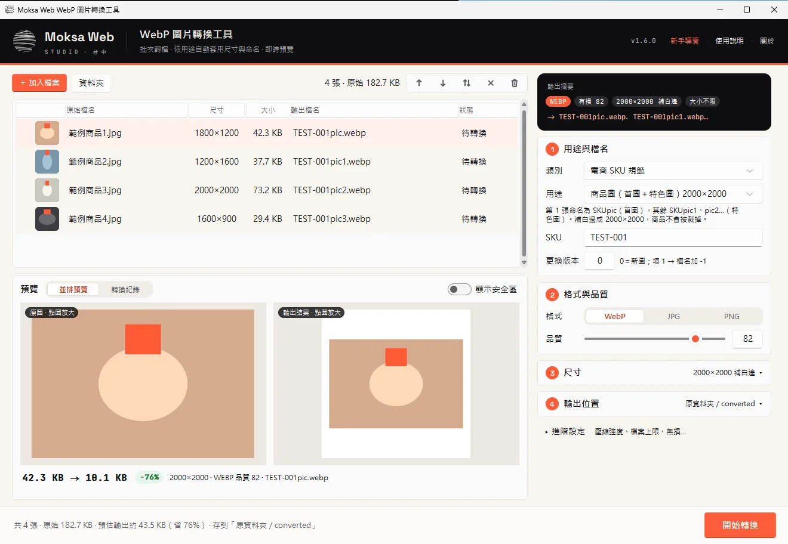
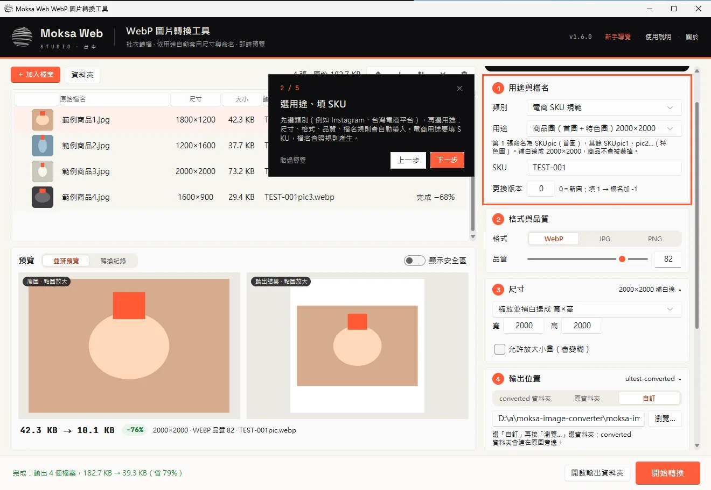
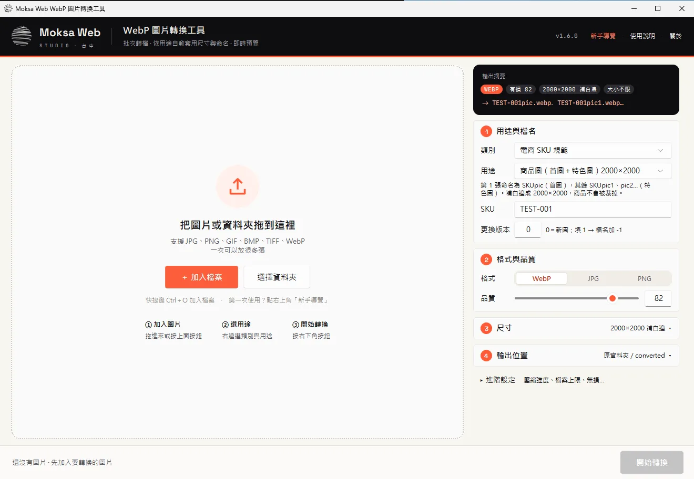
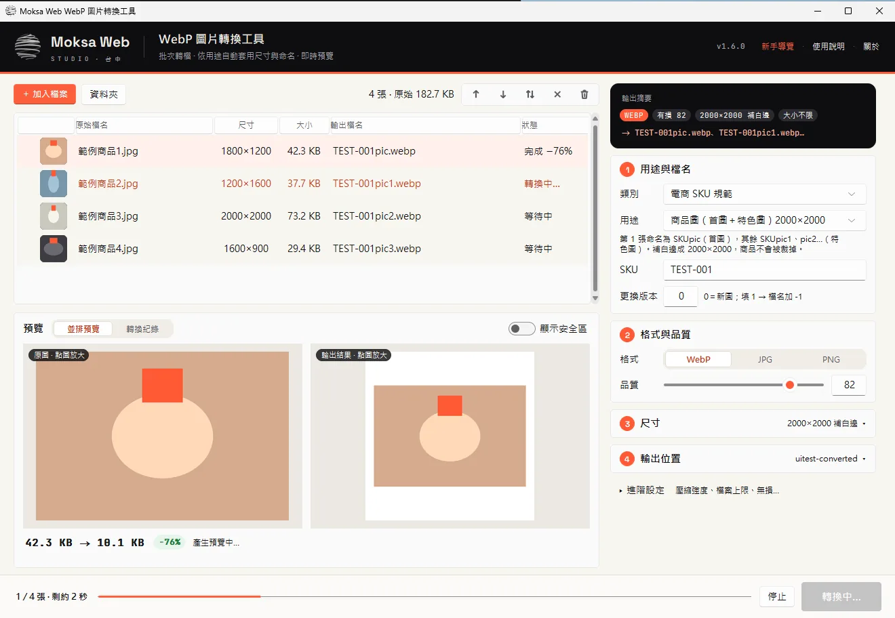
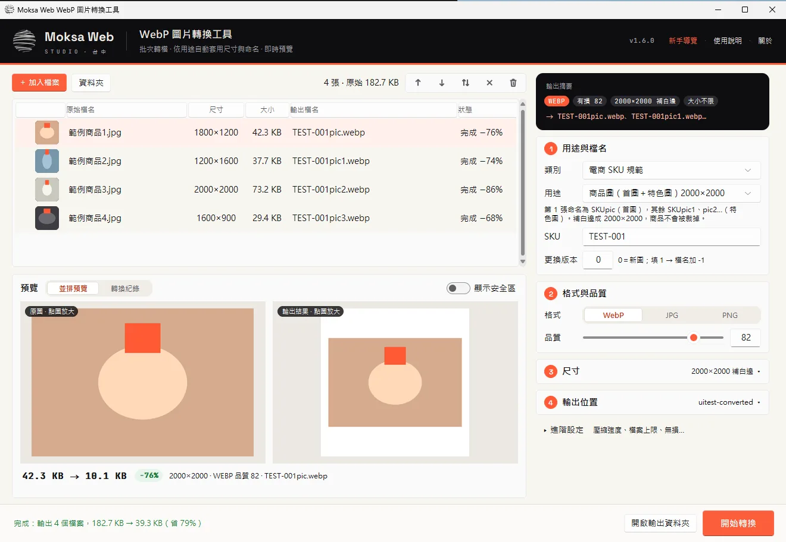
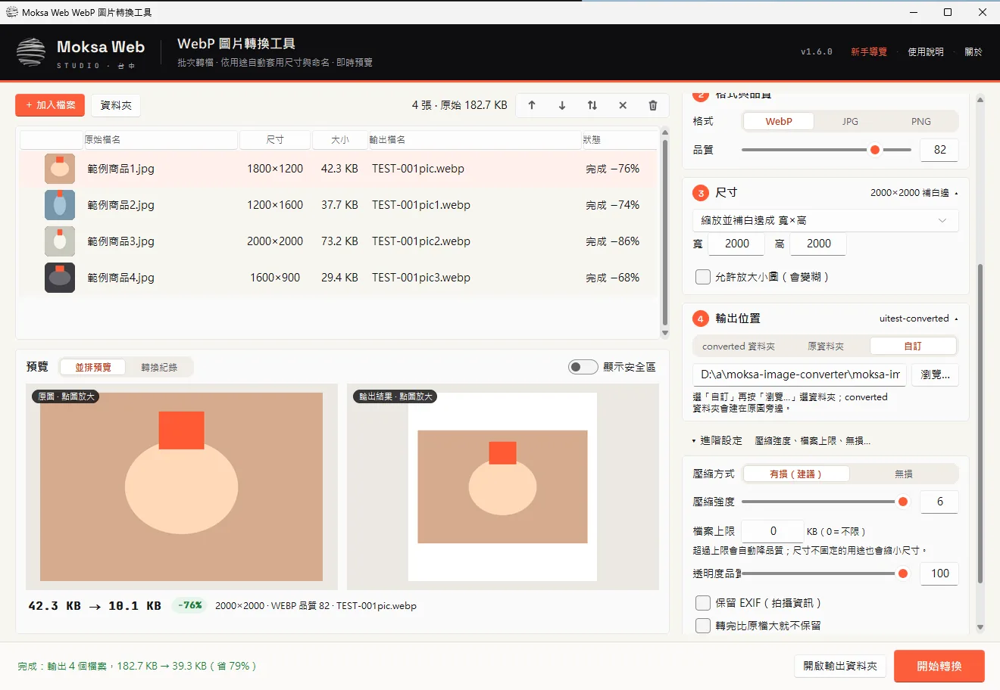
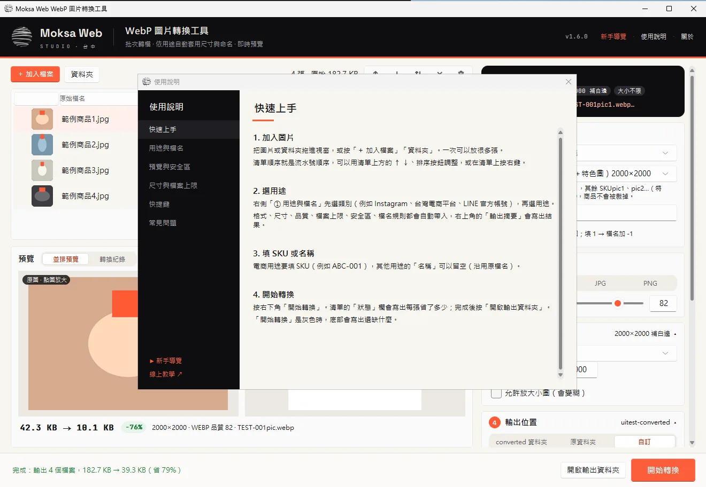
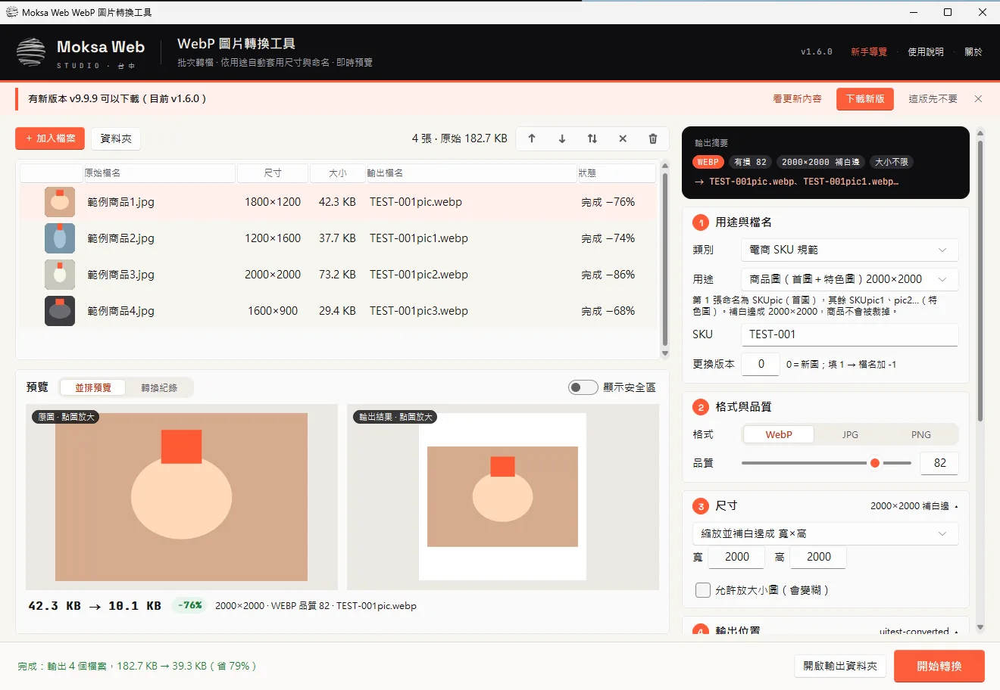
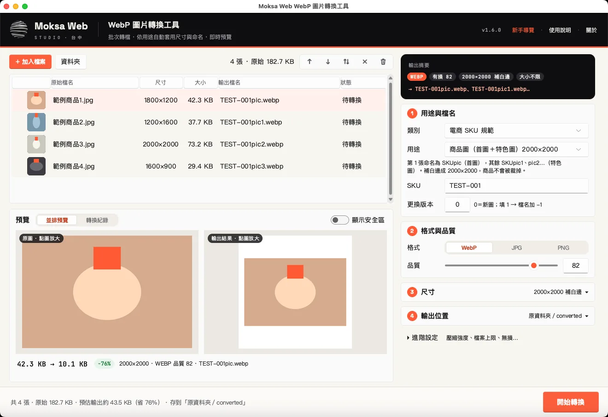

# Moksa Web WebP 圖片轉換工具

> A free, no-install batch image converter for Windows and macOS (JPG/PNG/GIF/BMP/TIFF/WebP → WebP/JPG/PNG) with 86 ready-made size presets for websites, LINE, Instagram, Facebook, X, YouTube, Google Ads and Taiwanese/global e-commerce platforms, live preview of the real output size, safe-zone overlays and SKU-based file naming. UI in Traditional Chinese. MIT licensed.

Moksa Web 的免安裝圖片轉換工具，支援 Windows 與 macOS（Apple 晶片、Intel）。
批次把 JPG／PNG／GIF／BMP／TIFF／WebP 轉成 WebP、JPG 或 PNG；選「類別 → 用途」就自動套用尺寸、格式、品質、檔案上限、安全區與檔名規則，轉換前可以即時預覽真實的檔案大小。

- 使用者說明：[`docs/使用說明_Windows.txt`](docs/使用說明_Windows.txt)（放進 Windows zip，檔名改成 `MoksaWeb-WebP轉換工具_使用說明.txt`）、[`docs/使用說明_Mac.txt`](docs/使用說明_Mac.txt)（放進 dmg）
- Mac 測試清單：[`docs/Mac測試清單.md`](docs/Mac測試清單.md)
- 維護說明：[`MAINTAINING.md`](MAINTAINING.md)
- 版本紀錄：[`CHANGELOG.md`](CHANGELOG.md)



## 圖文教學

### 1. 下載與開啟
- **Windows**：下載 `…-windows.zip`，按右鍵「解壓縮全部」，點兩下 `MoksaWeb-WebP轉換工具.exe`。
  跳出「Windows 已保護您的電腦」時，按「其他資訊」→「仍要執行」（沒有付費簽章，只有第一次會出現）。
- **Mac**：Apple 晶片下載 `…-mac-arm64.dmg`，Intel 下載 `…-mac-x86_64.dmg`。打開後把 App 拖進「應用程式」。
  第一次開啟：macOS 14 以前「按右鍵 → 打開」；macOS 15 以後到「系統設定 → 隱私權與安全性」按「仍要打開」。

第一次開啟會出現**新手導覽**，一步一步帶你走完；之後可以從右上角「新手導覽」再看一次。



### 2. 加入圖片
把圖片或資料夾拖進虛線框，或按「＋ 加入檔案」（快捷鍵 Ctrl／⌘＋O）。支援 JPG、PNG、GIF、BMP、TIFF、WebP，一次可以放很多張。



### 3. 選用途、填 SKU
右側「① 用途與檔名」先選**類別**（網站 WordPress、LINE 官方帳號、Instagram、Facebook、Google 廣告、蝦皮、momo…），再選**用途**。
尺寸、格式、品質、檔案上限、安全區、檔名規則都會自動帶入；右上角的**輸出摘要**會寫出結果。
電商用途要填 SKU，例如 `ABC-001` → `ABC-001pic.webp`、`ABC-001pic1.webp`…

點清單中的圖，下方會**真的轉一次**，告訴你轉完多大、省多少；打開「顯示安全區」可以看文字該放哪。


### 4. 開始轉換
按右下角「開始轉換」（Ctrl／⌘＋Enter）。轉換時會顯示進度與剩餘時間，清單的「狀態」欄寫出每張省了多少。
完成後按「開啟輸出資料夾」。




「開始轉換」是灰色時，底部會用橘字寫出還缺什麼（例如還沒填 SKU）。

### 5. 細部設定（需要時才用）
「③ 尺寸」「④ 輸出位置」平常收成一行，點標題展開；壓縮強度、檔案上限、無損等在「進階設定」。



### 6. 使用說明與更新
- 右上角「使用說明」（或按 F1）：快速上手、用途與檔名、預覽與安全區、尺寸與檔案上限、快捷鍵、常見問題。
- 有新版本時，頁首下方會出現橘色提示，按「下載新版」即可；設定會自動沿用。




Mac 版畫面：



## 資料夾結構

```
src/moksa_image_converter.py   主程式（單一檔案，tkinter 介面）
src/assets/presets.json        86 種用途預設（由 scripts/gen_presets.py 產生，不要手改）
src/assets/svtheme/            Sun Valley 主題，已改成品牌橘紅（由 scripts/prepare_assets.py 產生）
src/assets/fonts/              Space Grotesk、JetBrains Mono（SIL OFL）
src/assets/logo-*.png          品牌 logo（官網 FullLogo_Transparent_NoBuffer.png）
data/sizes.json                各平台尺寸規格原始資料（2026-10-02 查核）
scripts/gen_presets.py         產生 presets.json（電商 SKU 規範、網站、LINE 規範寫在這支程式裡）
scripts/prepare_assets.py      重新產生品牌主題與下載字型
packaging/                     圖示（.ico／.icns）與 Windows 版本資訊
.github/workflows/build.yml    自動打包 Windows .zip 與 macOS .dmg，並建立 Release
```

## 開發

```bash
pip install -r requirements.txt
python src/moksa_image_converter.py              # 開啟視窗
python src/moksa_image_converter.py --selftest out   # 不開視窗，試轉幾種用途，結果在 out/selftest.txt
python src/moksa_image_converter.py --uitest out     # 開視窗跑一輪：空白狀態、加圖、實際轉換、設定展開，檢查並截圖，結果在 out/uitest.txt
python src/moksa_image_converter.py --uitest out --screen 1366x768   # 模擬小螢幕
```

## 檢查更新

工具開啟時會向 `Moksa1123/moksa-webp-converter` 的 GitHub Releases 查詢最新版本（一天一次，`fetch_latest()`），有新版就在頁首下方顯示提示。所以**發版一定要推到公開 repo**，客戶才收得到通知；發版說明取自 `CHANGELOG.md` 對應版本那一段。

## 更新尺寸規格

1. 修改 `data/sizes.json`（平台規格），或修改 `scripts/gen_presets.py` 裡的 `CUSTOM_TOP`（電商 SKU 規範）、`WEB_SITE`（網站）、`LINE_SPEC`（LINE）。
2. 執行 `python scripts/gen_presets.py`，確認最後一行印出「品牌字樣殘留：無」。
3. 依下方步驟發版。

單一客戶要專屬清單時不必改程式：把一份 `presets.json` 放在 exe 旁邊（Windows），或 `~/Library/Application Support/Moksa Web/`（Mac），工具會優先使用它，「關於」視窗會顯示目前使用自訂清單。

## 發版

1. 修改 `src/moksa_image_converter.py` 的 `APP_VERSION`、`packaging/version_info.txt` 的版本、`docs/使用說明_Windows.txt` 與 `docs/使用說明_Mac.txt` 的標題（兩份共用的段落要一起改）、`CHANGELOG.md`。
2. 推送標籤：`git tag v1.4.1 && git push origin v1.4.1`
3. GitHub Actions 會打包、執行自我測試，並建立 Release，附上：
   - `MoksaWeb-ImageConverter-<版本>-windows.zip`（內含 `MoksaWeb-WebP轉換工具.exe` 與使用說明）
   - `MoksaWeb-ImageConverter-<版本>-mac-arm64.dmg`（Apple 晶片）
   - `MoksaWeb-ImageConverter-<版本>-mac-x86_64.dmg`（Intel，GitHub 有提供此主機時才會產生）

Mac 版未做 Apple 簽章與公證，第一次開啟要放行：macOS 14 以前「按右鍵 → 打開」；macOS 15 以後到「系統設定 → 隱私權與安全性」按「仍要打開」（詳見 `docs/使用說明_Mac.txt`）。

## 下載

到 [Releases](../../releases) 下載最新版：Windows 用 `…-windows.zip`，Mac 依晶片選 `…-mac-arm64.dmg`（Apple 晶片）或 `…-mac-x86_64.dmg`（Intel）。

## 授權

程式碼以 [MIT](LICENSE) 授權。第一方以外的元件見 [THIRD-PARTY-NOTICES.md](THIRD-PARTY-NOTICES.md)。
Moksa Web 名稱與 logo 不在 MIT 授權範圍內；改版再發布時請換成自己的名稱與圖示。

© Moksa Web・台中的網站工程工作室　https://moksaweb.com/
